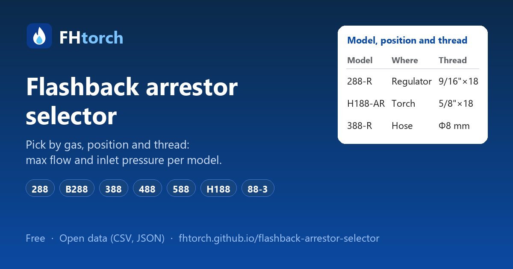

# FHtorch Flashback Arrestor Selector

Free, open data and a small selector for oxy-fuel **flashback arrestors and check valves**:
regulator, torch-handle and hose-line models for oxygen and fuel gas, with connection threads, max flow and max inlet pressure.

Made by [FHtorch](https://fhtorch.com/?utm_source=github&utm_medium=readme&utm_campaign=flashback-arrestor-selector), an oxy-fuel cutting and welding torch factory in Ningbo, China.

**Use it online:** https://fhtorch.github.io/flashback-arrestor-selector/

## What it does

- Choose the gas (oxygen or fuel gas), where the device goes (regulator outlet, torch or hose line), the connection thread and the type (flashback arrestor or check valve).
- The selector lists every matching FHtorch model with its inlet and outlet threads, max flow (L/h and cfh) and max inlet pressure (bar and psi), and names the matching model for the other gas line.
- The full list is below, and the same data is in [`data/`](data/) as JSON and CSV.
- No sign-up, no tracking, no build step: `index.html` works from GitHub Pages or from a downloaded copy.

## The data

- Every model, gas, mounting position, flow, pressure and thread comes from a specification table on an FHtorch product page. Every record keeps its `source_url`.
- In this list, oxygen models have right-hand (R.H.) threads and fuel gas models left-hand (L.H.) threads.
- cfh = L/h / 28.317 and psi = bar × 14.504, rounded.
- Rebuild the files from the live pages with `python scripts/build_data.py` (Python 3, no packages needed).

| Field | Meaning |
|---|---|
| `model`, `series` | FHtorch model (e.g. `288-R`) and series (`288`) |
| `device` | `flashback arrestor` or `check valve` |
| `gas` | `Oxygen` or `Fuel gas`, as listed |
| `mounting` | Where it goes, as listed (`Regulator`, `Torch`, `Hose`, `Torch / regulator`, or between torch handle and hoses) |
| `max_flow_lph`, `max_flow_cfh` | Max flow |
| `max_inlet_bar`, `max_inlet_psi` | Max inlet pressure (for fuel gas models with two values: the acetylene value) |
| `max_inlet_bar_other_fuel_gases`, `max_inlet_psi_other_fuel_gases` | Max inlet pressure for fuel gases other than acetylene, where the page lists one (H188 fuel gas models) |
| `inlet`, `outlet` | Threads as listed; `connection` and `hand` split them for filtering |
| `other_gas_model` | Same series and thread, for the other gas line |
| `source_url` | The page the row comes from |

## Models

<!-- CHART:START -->

### 288 (flashback arrestor, regulator outlet)

Fits on the regulator outlet. Flame arrestor with non-return valve; a filter protects it from dirt particles; stops a flashback from travelling upstream into the connected equipment. Source: [fhtorch.com/product/regulator-flashback-arrestors-check-valves/](https://fhtorch.com/product/regulator-flashback-arrestors-check-valves/?utm_source=github&utm_medium=readme)

| Model | Gas | Mounting | Max flow (L/h) | Max inlet pressure (bar) | Inlet | Outlet |
|---|---|---|---|---|---|---|
| 288-R | Oxygen | Regulator | 7000 | 10 | 9/16"×18 R.H. | 9/16"×18 R.H. |
| 288-L | Fuel gas | Regulator | 2600 | 1.5 | 9/16"×18 L.H. | 9/16"×18 L.H. |

### B288 (flashback arrestor, regulator outlet)

Fits on the regulator outlet, with BSP 3/8" threads. Flame arrestor with non-return valve; a filter protects it from dirt particles. Source: [fhtorch.com/product/regulator-flashback-arrestors-check-valves/](https://fhtorch.com/product/regulator-flashback-arrestors-check-valves/?utm_source=github&utm_medium=readme)

| Model | Gas | Mounting | Max flow (L/h) | Max inlet pressure (bar) | Inlet | Outlet |
|---|---|---|---|---|---|---|
| B288-RGB | Oxygen | Regulator | 7000 | 10 | BSP 3/8" R.H. | BSP 3/8" R.H. |
| B288-LGB | Fuel gas | Regulator | 2600 | 1.5 | BSP 3/8" L.H. | BSP 3/8" L.H. |

### 88-3 (check valve, torch)

Compact check valve for the torch. Source: [fhtorch.com/product/regulator-flashback-arrestors-check-valves/](https://fhtorch.com/product/regulator-flashback-arrestors-check-valves/?utm_source=github&utm_medium=readme)

| Model | Gas | Mounting | Max flow (L/h) | Max inlet pressure (bar) | Inlet | Outlet |
|---|---|---|---|---|---|---|
| 88-3-R | Oxygen | Torch | – | – | 9/16"×18 R.H. | 9/16"×18 R.H. |
| 88-3-L | Fuel gas | Torch | – | – | 9/16"×18 L.H. | 9/16"×18 L.H. |

### 388 (flashback arrestor, hose line)

Inline cartridge type for Φ8 mm hose. Source: [fhtorch.com/product/cartridge-flashback-arrestors-388-488-588/](https://fhtorch.com/product/cartridge-flashback-arrestors-388-488-588/?utm_source=github&utm_medium=readme)

| Model | Gas | Mounting | Max flow (L/h) | Max inlet pressure (bar) | Inlet | Outlet |
|---|---|---|---|---|---|---|
| 388-R | Oxygen | Hose | 7000 | 10 | Φ8 mm hose | Φ8 mm hose |
| 388-L | Fuel gas | Hose | 2600 | 1.5 | Φ8 mm hose | Φ8 mm hose |

### 488 (flashback arrestor, hose line)

Inline cartridge type for Φ8 mm hose. Source: [fhtorch.com/product/cartridge-flashback-arrestors-388-488-588/](https://fhtorch.com/product/cartridge-flashback-arrestors-388-488-588/?utm_source=github&utm_medium=readme)

| Model | Gas | Mounting | Max flow (L/h) | Max inlet pressure (bar) | Inlet | Outlet |
|---|---|---|---|---|---|---|
| 488-R | Oxygen | Hose | 7000 | 10 | Φ8 mm hose | Φ8 mm hose |
| 488-L | Fuel gas | Hose | 2600 | 1.5 | Φ8 mm hose | Φ8 mm hose |

### 588 (flashback arrestor, torch or regulator)

Cartridge type for torch or regulator mounting, 9/16"×18 inlet. Source: [fhtorch.com/product/cartridge-flashback-arrestors-388-488-588/](https://fhtorch.com/product/cartridge-flashback-arrestors-388-488-588/?utm_source=github&utm_medium=readme)

| Model | Gas | Mounting | Max flow (L/h) | Max inlet pressure (bar) | Inlet | Outlet |
|---|---|---|---|---|---|---|
| 588-R | Oxygen | Torch / regulator | 7000 | 10 | 9/16"×18 R.H. | – |
| 588-L | Fuel gas | Torch / regulator | 2600 | 1.5 | 9/16"×18 L.H. | – |

### H188 (flashback arrestor, between torch handle and hoses)

Fits between the torch handle and the hoses. A filter protects it from dirt particles; non-return valve. Source: [fhtorch.com/product/h188-torch-flashback-arrestors/](https://fhtorch.com/product/h188-torch-flashback-arrestors/?utm_source=github&utm_medium=readme)

| Model | Gas | Mounting | Max flow (L/h) | Max inlet pressure (bar) | Inlet | Outlet |
|---|---|---|---|---|---|---|
| H188-R | Oxygen | Between torch handle and hoses | 7000 | 10 | 9/16"×18 R.H. | 9/16"×18 R.H. |
| H188-L | Fuel gas | Between torch handle and hoses | 2600 | 1.5 (acetylene) / 5 (other fuel gases) | 9/16"×18 L.H. | 9/16"×18 L.H. |
| H188-RGB | Oxygen | Between torch handle and hoses | 7000 | 10 | BSP 3/8" R.H. | BSP 3/8" R.H. |
| H188-LGB | Fuel gas | Between torch handle and hoses | 2600 | 1.5 (acetylene) / 5 (other fuel gases) | BSP 3/8" L.H. | BSP 3/8" L.H. |
| H188-AR | Oxygen | Between torch handle and hoses | 7000 | 10 | 5/8"×18 R.H. | 5/8"×18 R.H. |
| H188-AL | Fuel gas | Between torch handle and hoses | 2600 | 1.5 (acetylene) / 5 (other fuel gases) | 5/8"×18 L.H. | 5/8"×18 L.H. |
| H188-RA | Oxygen | Between torch handle and hoses | 7000 | 10 | BSP 1/4" R.H. | BSP 1/4" R.H. |
| H188-LA | Fuel gas | Between torch handle and hoses | 2600 | 1.5 (acetylene) / 5 (other fuel gases) | BSP 1/4" L.H. | BSP 1/4" L.H. |

<!-- CHART:END -->

## Flashback arrestor or check valve?

See our article [Flashback arrestor vs check valve](https://fhtorch.com/flashback-arrestor-vs-check-valve/?utm_source=github&utm_medium=readme&utm_campaign=flashback-arrestor-selector). FHtorch also makes a [cutting torch with built-in flashback arrestors and reverse-flow check valves](https://fhtorch.com/product/cutting-torch-built-in-flashback-arrestors/?utm_source=github&utm_medium=readme&utm_campaign=flashback-arrestor-selector) (model MH001-005).

## Safety

These are catalog values for FHtorch products. Always follow the instructions of your torch and regulator manufacturer, and your local safety rules.

## More free FHtorch tools

- [Oxy-fuel cutting tip size chart and picker](https://fhtorch.github.io/cutting-tip-chart/) ([source](https://github.com/fhtorch/cutting-tip-chart))
- [Gas welding tip size chart and finder](https://fhtorch.github.io/welding-tip-chart/) ([source](https://github.com/fhtorch/welding-tip-chart))

## About FHtorch

FHtorch supplies distributors and welding supply stores with cutting torches, welding torches, cutting and welding tips, flashback arrestors and torch kits. Our torches are made at our family-owned factory in Ningbo, China, registered in 2019. MOQ 100–300 units per model; custom logo marking (OEM) available.

- Website: https://fhtorch.com/?utm_source=github&utm_medium=readme&utm_campaign=flashback-arrestor-selector
- Flashback arrestors: https://fhtorch.com/product-category/flashback-arrestors/?utm_source=github&utm_medium=readme&utm_campaign=flashback-arrestor-selector
- Request a quote: https://fhtorch.com/contact/?utm_source=github&utm_medium=readme&utm_campaign=flashback-arrestor-selector

## License

- Code (`index.html`, `scripts/`): [MIT](LICENSE).
- Data (`data/`): [CC BY 4.0](LICENSE-DATA). Please credit "FHtorch (fhtorch.com)".
